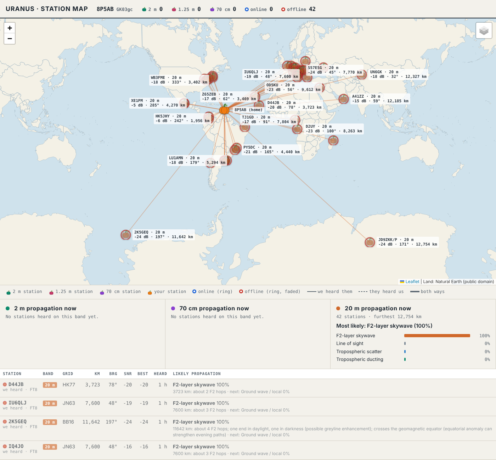

**Space weather (NOAA SWPC forecast issued 14 Nov 2026 22:00 UTC; observed indices not yet retrieved).**
Geomagnetic field expected quiet on 15 Nov and quiet to unsettled on 16 Nov, with minor-storm levels possible
on 17 Nov; solar activity low (eight numbered sunspot regions, 25 % daily chance of an M-class flare).
A NOAA storm watch posted on 15 Nov allows Kp 5 within 48 h. Quiet conditions overnight favour stable
night-time F2 on 20 m, which matches the steady 4-7 h of European, South American and African decodes.

**Barbados weather (November climatology; hourly observations for the night were not retrieved).**
Sea surface temperature about 28 °C (27.3-29.4 °C around the island), relative humidity about 75-85 %,
night air temperature 23-26 °C, east to east-north-east trade winds.

**What the weather can and cannot explain.** Sea temperature, humidity and pressure shape the lowest
2-3 km of the atmosphere. They drive tropospheric ducting on 2 m and 70 cm - the research focus of
Octopus - but they have no measurable effect on 20 m, which travels via the F2 layer 250-400 km up, or on
trans-equatorial propagation (TEP), which is an ionospheric effect of the equatorial anomaly. Tonight's
20 m results are explained by the ionosphere, not the weather.

**TEP geometry from Barbados.** At Barbados's longitude the geomagnetic (dip) equator lies near 13 °S.
Barbados (13.1 °N) is about 26 ° north of it; Buenos Aires and Montevideo (34.5 °S) are about 22 ° south -
close to the mirror geometry that 6 m and 2 m TEP needs. LU1AMN, LW7ELF, LU1DG and CX5AE were all decoded
on 20 m around 23:00 local solar time, the classic evening TEP window. Octopus will watch 144.174 MHz FT8
toward Argentina, Uruguay and southern Brazil in the evenings, especially near the equinoxes and at high
solar flux.

**Other anomalies (by inspection).**
- **Z49HKN** (KO02, -24 dB): Z4 is not a prefix in use as far as this analysis knows, and the decode sits
  at the FT8 threshold. Treated as a probable false decode.
- **D44JB** (Cape Verde, 3,723 km): best +29 dB earlier in the night, -20 dB when last heard - a 49 dB
  swing, consistent with deep fading on a short-skip path, or a nearby strong signal at the time.
- **IZ2QSE** in JN61: IZ2 calls are normally in northern Italy (JN45/JN55); JN61 is around Rome.
  Probably portable or a grid typo at the sender; kept in the analysis.

**Figure.** 
Uranus station map of the transcribed spots. The two "stations" off Antarctica (2K5GEQ in BB16 and
JD9ZKK/P in NB24) are the false decodes; from v0.21.0 Uranus keeps such decodes off the map and PSK Reporter.
